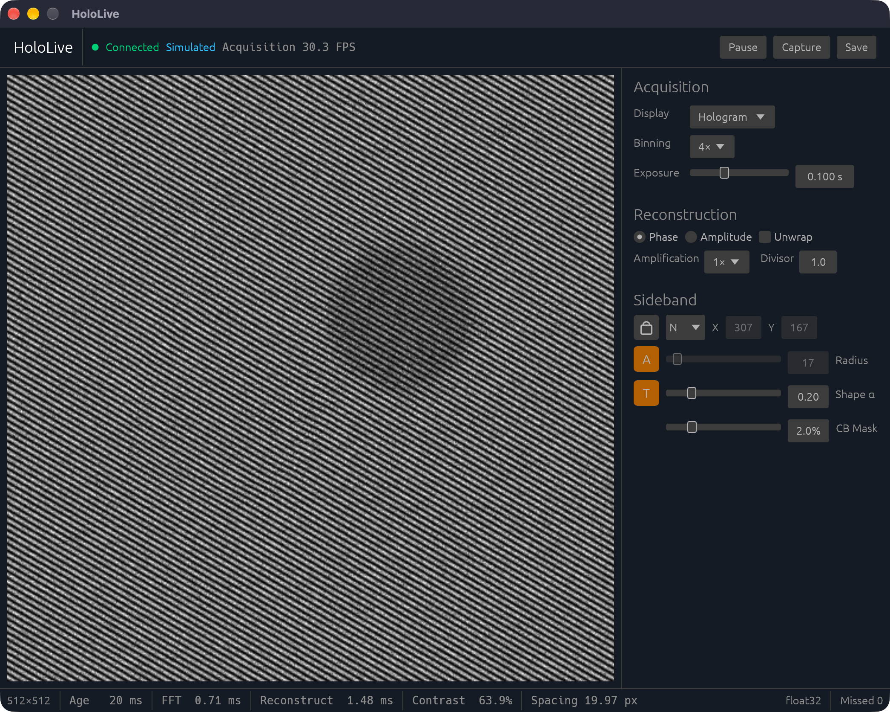
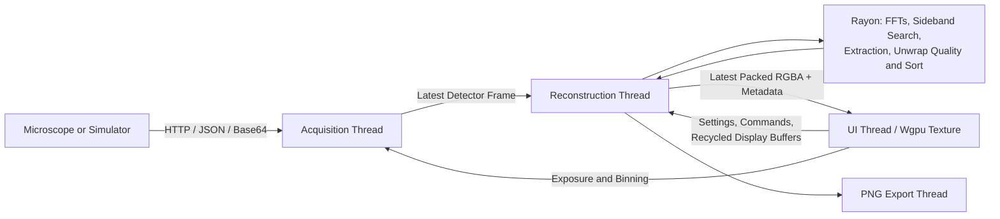

# Live Off-Axis Electron Holography Reconstruction

Live phase and amplitude reconstruction for off-axis electron holography with FEI™ microscopes, implemented as a native Rust application using `egui`, `wgpu`, RustFFT, and the `temscript` HTTP interface.



The retrieval of the $2\pi$-wrapped phase image works by taking the detector readout, Fourier transforming it such that the autocorrelation lies in the center, automatically finding the sideband in the specified image area, centering a cut-out around the sideband with a width of $1/3$ of the distance between the autocorrelation and the sideband through zero padding in Fourier space and calculating the angle of the complex argument of the inverse Fourier transform. The reconstructed amplitude in turn is defined as the the absolute value of the inverse Fourier transform.

Masking of the sideband in Fourier space is performed using a radial Tukey filter with an adjustable shape/cutoff to suppress Fourier artifacts. Additional filters implemented in the core library (such as a Butterworth filter for smoothing, a Gaussian line filter for suppressing Fresnel diffraction at the biprism filament or a center-cross filter for dealing with Gibbs-Wilbraham artifacts[^1]) are available in [`filters.rs`](crates/hololive-core/src/dsp/filters.rs).

Distortion-induced phase modulations can optionally be corrected using an empty hologram (i.e. without the specimen in the field of view) as a reference hologram. Furthermore, a continuous phase image can be retrieved by applying a phase unwrapping algorithm that attempts to remove any $2\pi$-jumps present in the reconstruction.

Estimation of the fringe contrast in Fourier space is defined as twice the amplitude fraction of the sideband and the centerband (i.e. the autocorrelation).[^2] The fringe spacing is defined as the real-space period of the interference fringes, determined by the spatial frequency separation between the sideband and the centerband (i.e. the Euclidean norm of their separation in Fourier space), assuming that the Nyquist criterion is not violated[^3].

[^1]: This could, in theory, also be achieved by multiplying the hologram with an apodization window prior to Fourier transformation; however, this would introduce other artifacts in the sideband region.

[^2]: Due to spectral leakage of both the sideband and centerband into neighbouring pixels, one would, in practice, integrate both over a small circular mask. For performance reasons, this step is omitted here.

[^3]: This assumption is often violated when detector binning is used, since the reduced sampling can result in values >0.5 cycles/px and therefore aliasing, meaning the extracted fringe spacing is often not reliable and should be taken with a grain of salt.

## Architecture and Performance

Acquisition, reconstruction, and the UI run on separate OS threads. Simulated mode adds a dedicated HTTP server thread; PNG export and file logging use helper threads. Actual throughput depends on detector readout, HTTP transfer, image size, precision, and whether phase unwrapping is enabled.



### Threading and Buffer Reuse

- **Acquisition** blocks on the camera or simulator, decodes the response, converts samples to the selected precision, and publishes the newest detector frame.
- **Reconstruction** owns the FFT engine, retained frame, reference wave, display levels, and reusable output buffers. It sleeps until a frame, command, or shutdown wakeup arrives. Rayon handles the parallel numerical stages; the simulator generates and compresses its frames independently of that pool.
- **UI** receives packed pixels and uploads them to a persistent GPU texture. The texture is recreated only when its dimensions change; filtering is updated separately. Wgpu handles display, while reconstruction runs on the CPU. Status and frame age refresh independently of acquisition, and completed results request a repaint.

Detector frames, reconstruction settings, and live results use single-value `LatestSlot` storage. New values replace pending older ones, keeping the display responsive without building a frame backlog. An in-flight reconstruction finishes and publishes its result; the newest pending frame is processed next. Overwritten detector buffers and replaced display buffers are reused.

Reconstruction control changes immediately recalculate the retained frame, including while paused. The forward FFT is cached by detector sequence and dimensions, so crop, Tukey, mask, lock, and extraction changes reuse its spectrum. Switching the displayed view only re-packs the retained data. The previous image stays visible for up to 250 ms while waiting for the new view; reconstruction failures are shown immediately. Pause stops acquisition and consumption of new frames; work already in progress may still finish.

Reference capture reconstructs the retained frame, stores its uncorrected complex wave, locks the sideband and crop, and immediately reconstructs with that reference. An incompatible reference is cleared by the reconstruction worker before retrying. Hologram and spectrum views continue updating after a reconstruction failure, with unavailable metrics and overlays omitted. PNG export copies the reconstructed values to a helper thread, which is joined during shutdown.

### Reconstruction

FFT plans, scratch pools, Tukey windows, and large intermediate buffers are reused. Spectra stay in native FFT order: centered crop and display coordinates are mapped into the buffer without constructing a full-array `fftshift` copy.

A two-dimensional FFT uses parallel row transforms, a cache-tiled transpose with 32×32 tiles, and a second row pass for the columns. Scratch storage is shared across successive transforms through reusable work blocks.

- **Sideband detection** searches rows in the selected half-plane, excluding the circular centerband mask. Equal maxima resolve in row-major order; a locked sideband skips the search.
- **Crop and filtering** copy the sideband through precomputed column indices into a zero-padded inverse buffer. Automatic crop radius is one-sixth of the center-to-sideband distance, rounded to the nearest pixel and limited to fit the detector and output. The radial Tukey window is interpolated from a symmetric one-dimensional window and cached by crop size and alpha. Two-pixel crops are left unwindowed to preserve their signal.
- **Wave extraction** runs in parallel: modulus gives amplitude, while `atan2` gives phase. Wrapped phase supports integer amplification; unwrapped phase uses the unamplified angle. Reference correction divides by the captured complex wave, mapping negligible or non-finite reference samples to zero.
- **Phase unwrapping** uses Arevalillo–Herráez (2002) second-difference path following in place. Pixel reset, reliability calculation, adjacency-edge construction, stable sorting, and the combined output/min–max pass run in parallel. Equal-quality edges retain their insertion order; the Kruskal group merge stays serial. Reused workspace holds pixel links, reliability values, and edges; new pixel slots are initialized directly when the image grows.

**Divisor** sets a square output size from the larger detector axis. The requested size is kept at least 16 pixels and large enough for the latest reconstructed crop, then rounded up to a fast FFT length with prime factors in `{2, 3, 5, 7, 11}`. The default `f32` pipeline reduces memory traffic; select `--precision f64` for double precision throughout reconstruction.

### Display Levels

Only the active view is packed into opaque grayscale RGBA. Hologram samples come directly from the detector frame; spectrum samples are written as centered `ln(1+|z|)` values into reusable scratch.

Hologram, spectrum, and amplitude auto-contrast sample a rotating 4×4 grid on the reconstruction thread. The grid origin advances with the detector sequence, and percentile bounds are smoothed with `0.25 × new + 0.75 × previous`. Smoothing resets when the corresponding image dimensions change. Small images are scanned densely, and non-finite samples are excluded.

| View | Display range |
|---|---|
| Hologram | 0.1–99.9 percentiles |
| FFT spectrum | 0.01–99.9 percentiles |
| Amplitude | 1–99 percentiles |
| Wrapped phase | Fixed −π to π scale, nearest filtering |
| Unwrapped phase | Reconstructed min–max, linear filtering |

The spectrum's upper percentile suppresses isolated peaks such as DC. Unwrapped phase reuses the bounds recorded during unwrapping. Pixel packing maps non-finite values to black; PNG export uses the full finite min–max range rather than live display levels.

### Simulated Acquisition

The simulator generates, encodes, and serves each frame synchronously on its own thread. It uses the same temscript v1 JSON/base64 array format as live acquisition, with gzip level 5 for sufficiently large responses when the client accepts gzip. Target FPS and jitter pace the response stream.

Hologram generation uses row loops with carrier terms computed outside the inner loop. Scene selection happens once per frame, and vacuum skips object geometry. Intensity and noise use separate passes so the carrier loop can vectorize. Shot noise uses a Gaussian approximation, `I + sqrt(I × scale) × N(0,1)`, clamped at zero, with `scale = poisson_scale × counts` and a reusable `Xoshiro256PlusPlus` stream.

Detector binning is modeled analytically before generation: dimensions, summed counts, fringe sampling, bin-integration contrast, and noise parameters are transformed without allocating a full-resolution detector image.

## Crate Map

The workspace is split into five crates.

- **`hololive-core`** — Reconstruction engine (FFT, filters, sideband detection, Arevalillo second-difference unwrap). Phase unwrap is the `src/unwrap/` module in this crate. No random number generation, HTTP, or simulation.
- **`hololive-simulation`** — Synthetic holograms (`Scene`, `SimulationSettings`, `HologramGenerator`). Independent of `hololive-core`; validation uses `SimulationError`.
- **`temscript-client`** — HTTP client and array codec for the temscript v1 API.
- **`temscript-simulator`** — Loopback temscript server and fixture loading for offline development.
- **`hololive-app`** — GUI, acquisition/reconstruction pipeline, and the `HoloLive` binary.

## Installation

Install Rust 1.95 or newer from [rustup.rs](https://rustup.rs/), then build the optimized application with:

```bash
./build.sh
```

A workspace `cargo build` is enough to compile; `./build.sh` is the convenience wrapper for parallel builds and release defaults.

Release builds use optimization level 3, fat link-time optimization, one code-generation unit, stripped debug information, disabled incremental compilation, and abort-on-panic behavior. Debug builds (`./build.sh --debug`) skip LTO, keep incremental compilation, and split LLVM work across many codegen units so compiles can use the available cores. `./build.sh` always passes `--jobs` equal to the logical CPU count. Add `--native` to compile for this machine's CPU (`-C target-cpu=native`); that can help FFT-heavy code but the binary is no longer a generic `aarch64`/`x86_64` download.

## Usage

HoloLive starts in Simulated mode by default:

```bash
./build.sh run
```

`--release`, `--debug`, and `--native` remain build flags even after `run` (`./build.sh run --native` compiles for this CPU). Use `--` to forward application arguments unchanged, for example `./build.sh run -- --source live`.

The embedded simulator does not send traffic to a microscope PC. It exposes a `temscript`-compatible loopback server and exercises the same HTTP, JSON, gzip, base64, scalar decoding, acquisition, and reconstruction path used for a live microscope. Simulated hologram settings are loaded from `simulation.json` or `fixtures/simulation.json` in the current working directory; if neither file is present, the process uses `SimulatorConfig::default()` (UINT16 little-endian, 0.1 s exposure, 4× binning). [`fixtures/simulation.json`](fixtures/simulation.json) matches those static fields for disk overrides; it omits `seed`, so a loaded fixture draws a new seed unless you set one. The default models a 2048² detector at 4× binning but generates only the effective 512² frame: dimensions, summed counts, fringe sampling, bin-integration contrast, and shot noise are transformed before generation rather than downsampling a full-resolution image.

To serve that loopback camera as a standalone process (for another HoloLive instance or a temscript client):

```bash
./build.sh run -- simulator serve --host 127.0.0.1 --port 8080
```

UI settings are session-local and reset to the application defaults whenever HoloLive starts. Command-line server and camera overrides likewise apply only to the current run.

To connect to a microscope, `temscript` has to be running on the accompanying PC, which in turn requires the TEMScripting software interface from Thermo Fisher Scientific™ and FEI™. Start HoloLive with the corresponding IP address, port, and camera:

```bash
./build.sh run -- \
  --source live \
  --server http://192.168.99.10:8080 \
  --camera CCD
```

`temscript` has no authentication and should only be used on a trusted instrument network. HoloLive resets the selected detector to 4.0 s exposure and 1× binning when closing the application.

Live mode opens while the microscope server is unavailable and retries the connection. Acquisition responses support the decoder’s pixel limit across all supported scalar types, including 4096×4096 UINT32 detectors. Camera binning choices are loaded when it connects; if the initial 4× setting is unavailable, HoloLive chooses the closest supported mode.

Various keyboard shortcuts can be used to adjust parameters during live reconstruction:

- `L` locks or unlocks the sideband position, preventing it from being automatically recalculated until the lock is released. Disabling the sideband lock also clears the reference hologram.
- `UP/DOWN/LEFT/RIGHT` changes the sideband search half-plane when the sideband is unlocked.
- `TAB` switches between the reconstructed phase and amplitude.
- `A` cycles between $1$, $2$, $3$, and $4$ as an amplification factor for wrapped phase. It applies only in Phase mode with unwrap disabled.
- `F` enables or disables the Tukey filter applied to the sideband cut-out before zero padding.
- `U` enables or disables Arevalillo–Herráez (2002) second-difference phase unwrapping on the reconstructed phase.
- `R` captures or clears the current acquisition as a reference hologram. Capturing reconstructs the retained frame, locks the sideband to that wave, and applies the reference immediately even while paused.
- `S` saves the current reconstruction as a timestamped PNG.
- `P` pauses or resumes detector acquisition.

Changes to reconstruction controls immediately recalculate the retained current detector frame. **Divisor** (Reconstruction panel) scales the output FFT size relative to the detector. Switching the live view (hologram / spectrum / reconstruction) re-packs that frame without another FFT. If a new readout arrives during a transform, the bounded in-flight transform finishes and publishes while only the newest pending detector frame is retained for the next iteration.

Generated data is written to `exports/`. PNG finalization and buffered write errors are reported, and shutdown waits for a pending export to finish. Successful saves are confirmed temporarily in the header. `./build.sh clean` removes both Cargo build artifacts and generated exports.

Although HoloLive should in principle work with any detector supported by `temscript`, live validation and operator sign-off on the microscope are required before relying on it for instrument work.

## License

Copyright © 2023 [Hüseyin Çelik](https://www.github.com/hueseyincelik).

This project is licensed under [AGPL v3](/LICENSE).
